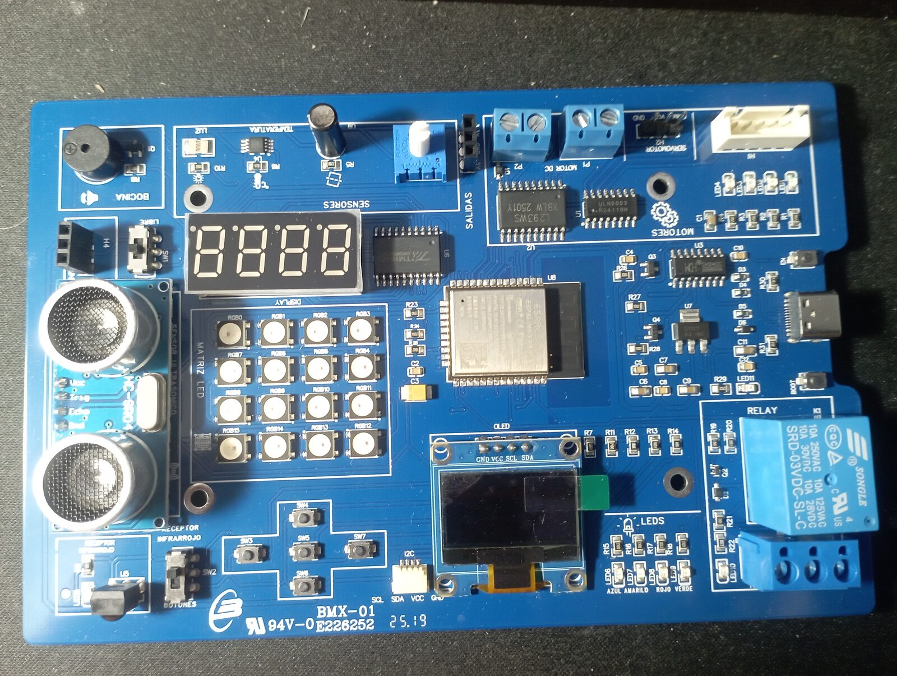
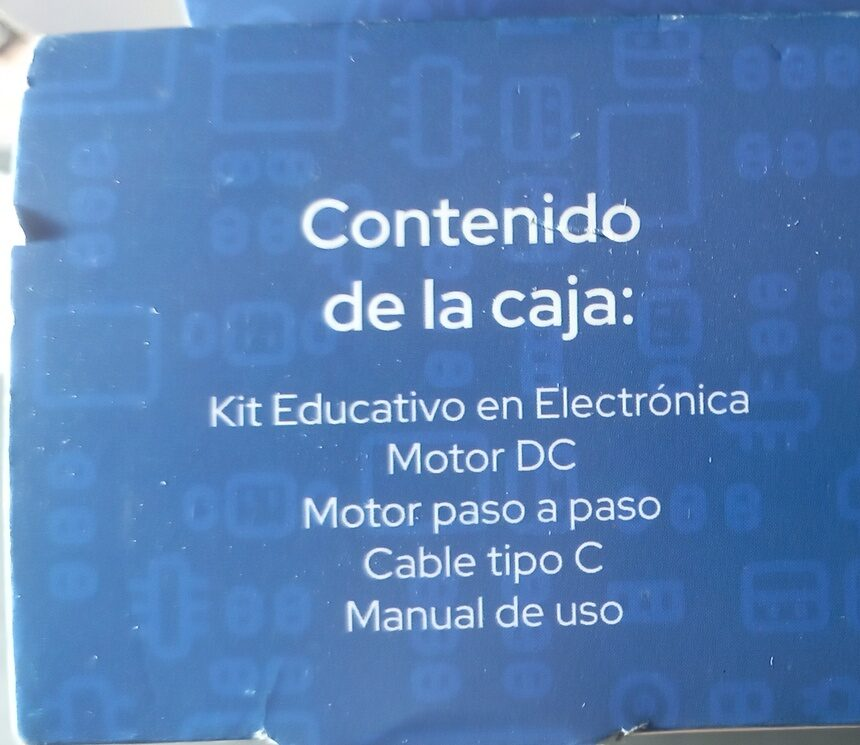
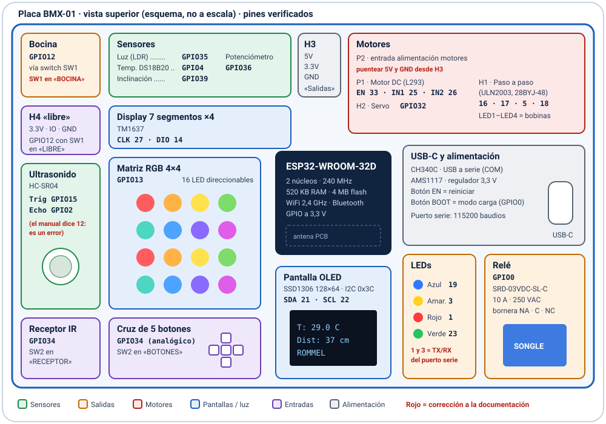
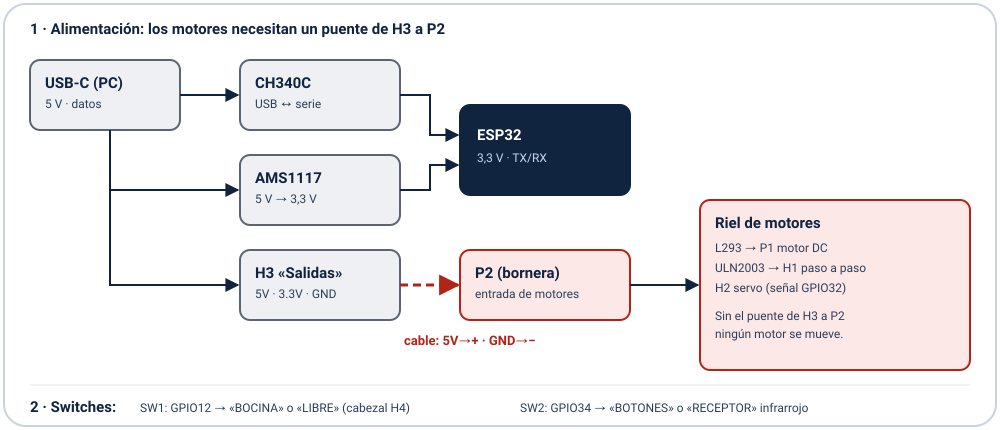

# 1. ¿Qué es este kit?

El **Kit Educativo en Electrónica** del programa **Semilleros Científicos** (Ministerio del Poder Popular para Ciencia y Tecnología y Gran Misión Ciencia, Tecnología e Innovación, Venezuela) es una **placa de entrenamiento "todo en uno"** llamada **BMX-01**. La fabrica *Sistemas Tecnológicos* y está hecha en Venezuela.

En el centro de la placa hay un microcontrolador **ESP32-WROOM-32D** de Espressif, rodeado de sensores, pantallas, salidas y controladores de motores **ya soldados y cableados**. No hace falta protoboard ni cables: basta conectarla al computador con un cable USB-C y empezar a programar.



**¿Para qué sirve?**

- Aprender **programación** (Arduino/C++ o MicroPython) con resultados visibles: luces, sonidos, pantallas y movimiento.
- Aprender **electrónica**: entradas y salidas digitales, señales analógicas, PWM, buses I2C y 1-Wire, control de motores.
- Hacer proyectos de **Internet de las Cosas (IoT)** gracias al WiFi y al Bluetooth integrados: estaciones meteorológicas, domótica, control desde el teléfono.
- Hacer **ciencia de datos en el aula**: medir temperatura, luz y distancia, y registrar y graficar las mediciones.

## 1.1 Contenido de la caja



- Placa BMX-01 (Kit Educativo en Electrónica)
- Motor DC
- Motor paso a paso (28BYJ-48)
- Cable USB tipo C
- Manual de uso (tarjeta con la leyenda de pines)

> El kit indica **"Prohibida su venta"**: es material educativo de distribución gratuita.

# 2. Características técnicas

| Bloque | Componente | Detalle |
|---|---|---|
| Cerebro | **ESP32-WROOM-32D** (chip ESP32-D0WD) | 2 núcleos a 240 MHz · 520 KB de RAM · 4 MB de flash |
| Radio | WiFi 802.11 b/g/n · Bluetooth clásico y BLE | Antena integrada en el módulo |
| USB | **CH340C** + conector USB-C | Puerto serie virtual (COM en Windows, `/dev/ttyUSB0` en Linux) |
| Energía | **AMS1117-3.3** | Regulador de 3,3 V. Los GPIO trabajan a **3,3 V** |
| Botones del sistema | **EN** (reinicio) y **BOOT** | BOOT = modo de carga (GPIO0) |
| Pantalla | **OLED SSD1306** de 128×64 píxeles | Bus I2C, dirección 0x3C |
| Display | 4 dígitos de 7 segmentos con **TM1637** | Puede mostrar números, horas (12:34) y algunas letras |
| Luces | **Matriz RGB 4×4** (16 LED direccionables) y 4 LED (azul, amarillo, rojo, verde) | Colores de 24 bits |
| Sonido | **Bocina** (buzzer) con transistor | Selección con el switch SW1 |
| Sensores | Temperatura **DS18B20** · luz (**LDR**) · **inclinación** · **potenciómetro** · ultrasonido **HC-SR04** · receptor **infrarrojo** | |
| Entradas | **Cruz de 5 botones** en un solo pin analógico | Selección con el switch SW2 |
| Potencia | **Relé SRD-03VDC-SL-C** | Hasta 10 A a 250 VAC (contactos NA, C y NC) |
| Motores | **L293** (motor DC) · **ULN2003** (paso a paso) · conector para **servo** | Alimentación por la bornera P2 |

# 3. Mapa de la placa y pines



Los pines de la tabla siguiente se **verificaron uno por uno** con el programa de diagnóstico de este proyecto. Las filas marcadas con ⚠ corrigen o completan lo que dice la documentación original.

| Periférico | GPIO | Notas |
|---|---|---|
| LED azul / verde | 19 / 23 | |
| LED rojo / amarillo | 1 / 3 | ⚠ Son TX y RX del puerto serie: si los usas, no puedes usar `Serial` al mismo tiempo |
| Bocina | 12 | ⚠ Solo suena con el **switch SW1 en "BOCINA"** (en "LIBRE", GPIO12 sale al cabezal H4) |
| Relé | 0 | GPIO0 es pin de arranque: puede hacer clic al encender o reiniciar |
| Matriz RGB 4×4 | 13 | LED tipo WS2812 en **zigzag** (fila 0 de izq. a der., fila 1 de der. a izq., …) |
| OLED | SDA 21 · SCL 22 | SSD1306, dirección I2C 0x3C |
| Display de 7 segmentos | CLK 27 · DIO 14 | Chip TM1637 |
| Temperatura | 4 | **DS18B20** digital (bus 1-Wire) |
| Inclinación | 39 | Solo entrada |
| Luz (LDR) | 35 | Analógico (0–4095) |
| Potenciómetro | 36 | Analógico (0–4095) |
| Ultrasonido HC-SR04 | Trig 15 · **Echo 2** | ⚠ El manual dice Echo = 12. **El pin correcto es 2** (como dice la serigrafía de la placa) |
| Botones (cruz) / receptor IR | 34 | ⚠ Comparten el pin: el **switch SW2** elige "BOTONES" o "RECEPTOR" |
| Motor paso a paso | 16 · 17 · 5 · 18 | ULN2003 → conector blanco H1 (LED1–LED4 muestran las bobinas) |
| Motor DC | EN 33 · IN1 25 · IN2 26 | L293 → bornera P1 |
| Servo | 32 | Conector H2 (GND · VCC · señal) |

## 3.1 Alimentación de los motores (¡importante!)



La bornera **P2** es la **entrada de alimentación de los motores** y **viene sin conectar** de fábrica. Si no se alimenta, **ni el motor DC, ni el paso a paso, ni el servo se mueven**, aunque el programa funcione bien.

**Solución:** con dos cables, lleva **5V** y **GND** del cabezal **H3** ("Salidas") a la bornera **P2** (5V al + y GND al −).

> El puerto USB de un computador entrega unos 500 mA. Si la placa **se reinicia** cuando arranca un motor, usa un cargador USB de 5 V y 2 A o más.

## 3.2 Switches

| Switch | Posición | Efecto |
|---|---|---|
| **SW1** | **BOCINA** | GPIO12 maneja la bocina |
| | LIBRE | GPIO12 sale al cabezal H4 para tus propios circuitos (la bocina queda muda) |
| **SW2** | **BOTONES** | GPIO34 lee la cruz de 5 botones |
| | RECEPTOR | GPIO34 lee el receptor infrarrojo (controles remotos) |

# 4. Primeros pasos

## 4.1 Instalar el software (Arduino IDE)

1. Descarga e instala **Arduino IDE 2** desde <https://www.arduino.cc/en/software>.
2. Instala el **controlador CH340** si Windows no reconoce la placa (Windows 10 y 11 suelen traerlo). Al conectarla, debe aparecer un puerto **COM** en el Administrador de dispositivos.
3. En Arduino IDE, abre *Archivo → Preferencias* y, en "URLs adicionales de gestor de placas", agrega:
   `https://espressif.github.io/arduino-esp32/package_esp32_index.json`
4. Abre *Herramientas → Placa → Gestor de placas*, busca **esp32** (de Espressif Systems) e instálalo (versión 3.x).
5. Elige *Herramientas → Placa → esp32 → **ESP32 Dev Module***.
6. Elige el **puerto** (COMx) en *Herramientas → Puerto*.
7. Instala estas librerías en *Herramientas → Administrar bibliotecas*:
   **Adafruit SSD1306**, **Adafruit GFX Library**, **Adafruit NeoPixel**, **TM1637** (de Avishay Orpaz), **OneWire**, **DallasTemperature** e **IRremote**.

## 4.2 Tu primer programa

Abre `ejemplos/01_parpadeo` y presiona **Subir** (la flecha →). El LED azul parpadeará cada medio segundo.

```cpp
const int LED_AZUL = 19;

void setup() {
  pinMode(LED_AZUL, OUTPUT);
}

void loop() {
  digitalWrite(LED_AZUL, HIGH);
  delay(500);
  digitalWrite(LED_AZUL, LOW);
  delay(500);
}
```

> Si la carga falla con *"Failed to connect"*, mantén presionado **BOOT** mientras empieza a cargar y suéltalo cuando aparezca "Connecting…".

## 4.3 Desde Linux o WSL (opcional)

En WSL2 hay que compartir el USB desde Windows (PowerShell como administrador):

```
usbipd list
usbipd bind --busid 1-11      (una sola vez; usa el BUSID de "USB-SERIAL CH340")
usbipd attach --wsl --busid 1-11
```

La placa aparecerá como `/dev/ttyUSB0`. Con **arduino-cli**:

```
arduino-cli core install esp32:esp32
arduino-cli compile --fqbn esp32:esp32:esp32 ejemplos/01_parpadeo
arduino-cli upload  -p /dev/ttyUSB0 --fqbn esp32:esp32:esp32:UploadSpeed=115200 ejemplos/01_parpadeo
```

> A través de usbip, las velocidades altas (460800 o 921600 baudios) pueden corromper datos. Usa **115200**.

# 5. Ejemplos incluidos

Cada ejemplo está en la carpeta `ejemplos/` y compila con el núcleo esp32 3.x.

| Ejemplo | Qué hace | Aprendes |
|---|---|---|
| `01_parpadeo` | Hace parpadear el LED azul | Salidas digitales |
| `02_potenciometro_led` | El potenciómetro regula el brillo del LED verde | Lectura analógica y PWM |
| `03_bocina_melodia` | Toca Do-Re-Mi-Fa-Sol-La-Si-Do | Tonos con LEDC (SW1 en BOCINA) |
| `04_temperatura_oled` | Termómetro en la pantalla OLED | Bus 1-Wire y bus I2C |
| `05_distancia_7seg` | Medidor de distancia en el display | Ultrasonido y `pulseIn` |
| `06_servo_potenciometro` | El servo sigue al potenciómetro | Pulsos de servo a 50 Hz |
| `07_matriz_arcoiris` | Arcoíris animado en la matriz 4×4 | LED direccionables y color HSV |

Ejemplo de **lectura analógica con PWM**:

```cpp
const int POT = 36, LED_VERDE = 23;

void setup() {
  Serial.begin(115200);
  ledcAttach(LED_VERDE, 5000, 8);      // PWM de 5 kHz, 8 bits
}

void loop() {
  int valor = analogRead(POT);         // 0 a 4095
  ledcWrite(LED_VERDE, map(valor, 0, 4095, 0, 255));
  delay(100);
}
```

# 6. Programa de diagnóstico

La carpeta `diagnostico_bmx01/` contiene un programa que **prueba todos los componentes** de la placa. Al encenderla ejecuta una batería automática de 15 pruebas, informa el resultado por el puerto serie (115200 baudios) y luego muestra **nombres rotativos** en la matriz, en el display y en la pantalla OLED.

Para compilarlo, en Arduino IDE elige *Herramientas → Partition Scheme → **Huge APP (3MB No OTA)***: con WiFi y Bluetooth juntos el programa no cabe en la partición por defecto.

Abre el **Monitor Serie** (115200 baudios), escribe una letra y pulsa Enter:

| Tecla | Prueba | Tecla | Prueba |
|---|---|---|---|
| `a` | Diagnóstico automático completo | `h` | Muestra el menú |
| `0` | Información del chip | `i` | Busca dispositivos I2C |
| `1` | LEDs | `2` | Bocina (melodía) |
| `3` | Relé | `4` | Matriz RGB |
| `5` | Pantalla OLED | `6` | Display de 7 segmentos |
| `7` | Lectura de todos los sensores | `8` | Motor DC |
| `9` | Motor paso a paso | `s` | Servo |
| `w` | Busca redes WiFi | `b` | Busca dispositivos Bluetooth LE |
| `m` | Monitor de sensores en vivo | `n` | Nombres rotativos |
| `e` | Sensor de estacionamiento (ultrasonido + bocina) | `p` | Punto de acceso WiFi con página web |
| `c` | Calibrar los botones | `j` | Juego con la cruz de botones |
| `r` | Receptor infrarrojo | `x` `y` `z` | Búsqueda de fallas: bocina, motores, servo |
| `T<pin>` | Tono en cualquier pin (ej. `T12`) | `S<pin>` | Servo en cualquier pin (ej. `S32`) |

**Página web de control (`p`):** la placa crea la red WiFi **BMX01-Diagnostico** (clave `semilleros`). Conéctate con el teléfono y abre <http://192.168.4.1> para ver los sensores en vivo y manejar el relé, los LEDs, la bocina, la matriz y el servo.

**Personalizar los nombres:** en `diagnostico_bmx01.ino`, edita la línea
`const char *NOMBRES[] = {"ROMMEL", "FIDIA"};`. Las letras disponibles en la matriz son A D E F I L M O R S Y y el signo +; para agregar otras, completa la tabla `FUENTE[]`.

# 7. Ideas de proyectos

**Para empezar**

- Semáforo con los LEDs y la bocina.
- Termómetro digital con alarma de temperatura alta.
- Lámpara automática: la LDR detecta oscuridad y enciende la matriz.
- Sensor de estacionamiento: la bocina pita más rápido mientras más cerca está el objeto.

**Intermedio**

- Juegos en la pantalla OLED o en la matriz con la cruz de botones (Simón dice, reflejos).
- Control de un motor o de un servo con un control remoto de TV (receptor IR).
- Alarma de movimiento con el sensor de inclinación.
- Registrador de datos: guardar temperatura y luz en la memoria y graficarlas en el computador.

**Avanzado (IoT)**

- **Estación meteorológica** que publica sus datos en la web (MQTT, ThingSpeak) o envía avisos por Telegram.
- **Domótica:** encender una lámpara real con el relé desde el teléfono.
- Robot o carrito controlado por Bluetooth.

> ⚠ **Seguridad con el relé:** conectar 110/220 V es peligroso. Hazlo solo con la supervisión de un adulto con experiencia, y nunca toques la bornera del relé con la placa conectada a la red eléctrica.

# 8. Solución de problemas

| Problema | Causa | Solución |
|---|---|---|
| La bocina no suena | El switch SW1 está en "LIBRE" | Pasa SW1 a la posición "BOCINA" |
| Ningún motor se mueve | La bornera P2 no tiene alimentación | Puentea 5V y GND de H3 a P2 |
| El servo solo da un salto o zumba | Conflicto de PWM entre librerías (servo a 50 Hz frente a la bocina a 2 kHz y el motor a 1 kHz) | Genera el servo con pulsos por software (ver `ejemplos/06`) o con un LEDC propio a 50 Hz |
| El servo no hace nada | Servo dañado o cable invertido | El cable marrón va a GND, el rojo a VCC y el naranja a la señal. Prueba con otro servo |
| El ultrasonido siempre marca −1 | Echo configurado en GPIO12 (según el manual) | Usa **Echo = GPIO2** |
| `Serial` deja de funcionar | Se usaron los LEDs rojo y amarillo (GPIO1 y GPIO3) | Evita esos LEDs, o llama a `Serial.end()` antes de usarlos y a `Serial.begin()` después |
| El programa no cabe | WiFi y Bluetooth juntos | *Partition Scheme* → "Huge APP (3MB No OTA)" |
| "Failed to connect" al cargar | No entró en modo de carga | Mantén **BOOT** presionado al iniciar la carga |
| La carga falla a mitad de camino (WSL/usbip) | Velocidad demasiado alta | `UploadSpeed=115200` |
| La placa se reinicia al abrir el monitor serie | Las señales DTR/RTS del CH340 controlan EN y BOOT | Es normal. Para no reiniciarla, desactiva DTR/RTS en tu programa de terminal |

# 9. Erratas de la documentación original

| Elemento | Dice la documentación | Comprobado en la placa |
|---|---|---|
| Echo del ultrasonido | GPIO12 (tarjeta del manual) | **GPIO2** (la serigrafía de la placa es correcta) |
| Bocina | GPIO12 | Correcto, **pero solo con SW1 en "BOCINA"** |
| Alimentación de los motores | No se menciona | **Puente de H3 (5V y GND) a P2** |
| Pantalla OLED | "SLC PGI022" | Es **SCL GPIO22** (error de tipeo) |
| Código QR del reverso | — | Contiene la **dirección MAC** de la placa, no un enlace al manual |

# 10. Respaldar y restaurar el firmware de fábrica

Antes de cargar tus programas puedes guardar una copia del firmware original (4 MB):

```
esptool --port COM7 --baud 115200 read-flash 0 0x400000 firmware_original.bin
```

Para restaurarlo:

```
esptool --port COM7 write-flash 0 firmware_original.bin
```

> A través de WSL/usbip, la lectura completa puede fallar con "Corrupt data". En ese caso lee en bloques de 16 KB con reintentos (ver `BITACORA.md`).

# 11. Créditos y licencia

- Kit y placa BMX-01: programa **Semilleros Científicos**, Mincyt y Gran Misión Ciencia, Tecnología e Innovación; fabricados por *Sistemas Tecnológicos*, Venezuela.
- **Desarrollo y ejemplos: Licenciado Físico Rommel Contreras** — proyecto **Kit_edu_Semilla** (<https://github.com/rommeljose/Kit_edu_Semilla>), desarrollado con ayuda de Claude Code.
- Código bajo licencia **MIT**; documentación bajo **CC BY-SA 4.0**. Puedes usarlo, copiarlo y mejorarlo en tu escuela o liceo.
