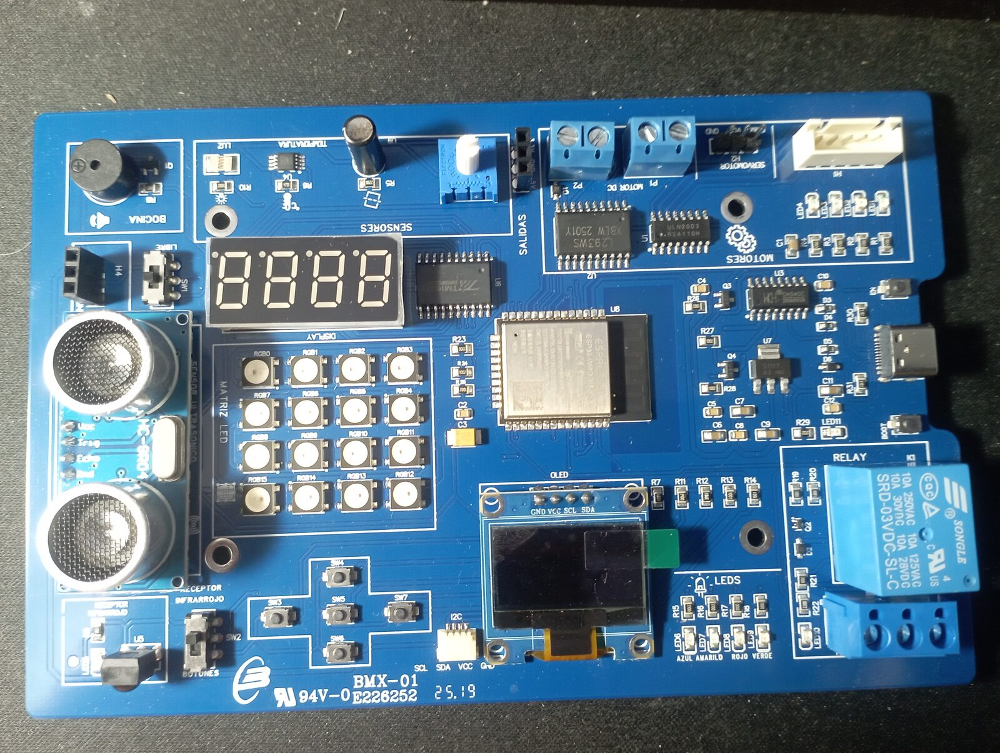

# Kit_edu_Semilla · Kit educativo BMX-01 (ESP32)

Guía, programa de diagnóstico y ejemplos para el **Kit Educativo en Electrónica BMX-01** del programa **Semilleros Científicos** (Mincyt y Gran Misión Ciencia, Tecnología e Innovación, Venezuela). La placa trae un **ESP32-WROOM-32D** con sensores, pantallas, relé y controladores de motores ya integrados.

**🌐 Página web:** https://rommeljose.github.io/Kit_edu_Semilla/
**📘 Guía de usuario (PDF):** [docs/guia/Guia_de_usuario_BMX-01.pdf](docs/guia/Guia_de_usuario_BMX-01.pdf)

## Contenido del repositorio

| Carpeta o archivo | Qué contiene |
|---|---|
| [`GUIA_DE_USUARIO.md`](GUIA_DE_USUARIO.md) | Guía de usuario completa (fuente del PDF) |
| [`diagnostico_bmx01/`](diagnostico_bmx01/) | Programa que prueba todos los componentes, con menú serie, monitor en vivo, página web de control y juegos |
| [`ejemplos/`](ejemplos/) | 7 ejemplos cortos: parpadeo, potenciómetro, bocina, termómetro OLED, distancia, servo y arcoíris |
| [`herramientas/`](herramientas/) | Puente serie para WSL/usbip y estilo del PDF |
| [`docs/`](docs/) | Página web (GitHub Pages), fotos, diagramas y PDF |
| [`BITACORA.md`](BITACORA.md) | Bitácora de trabajo: cómo se identificó, probó y corrigió cada componente |

## Mapa de pines verificado

| Periférico | GPIO | Periférico | GPIO |
|---|---|---|---|
| LED azul / verde / rojo / amarillo | 19 / 23 / 1 / 3 | OLED (I2C) | SDA 21 · SCL 22 |
| Bocina (**SW1 en «BOCINA»**) | 12 | Display de 7 segmentos (TM1637) | CLK 27 · DIO 14 |
| Relé | 0 | Matriz RGB 4×4 | 13 |
| Temperatura DS18B20 | 4 | Ultrasonido HC-SR04 | Trig 15 · **Echo 2** |
| Inclinación / luz / potenciómetro | 39 / 35 / 36 | Botones / receptor IR (SW2) | 34 |
| Paso a paso (ULN2003) | 16 · 17 · 5 · 18 | Motor DC (L293) | EN 33 · IN 25 / 26 |
| Servo | 32 | **Alimentación de los motores** | **Puente de H3 (5V y GND) a P2** |

## Erratas encontradas en la documentación original

1. **Echo del ultrasonido:** el manual dice GPIO12; el pin correcto es **GPIO2**.
2. **Bocina:** solo suena con el switch **SW1 en «BOCINA»** (de fábrica venía en «LIBRE»).
3. **Motores:** la bornera **P2** viene sin alimentación. Hay que llevarle **5V y GND desde H3**.

## Inicio rápido (Arduino IDE)

1. Instala el núcleo **esp32** de Espressif (3.x) y elige la placa **ESP32 Dev Module**.
2. Instala las librerías: Adafruit SSD1306, Adafruit GFX, Adafruit NeoPixel, TM1637 (Avishay Orpaz), OneWire, DallasTemperature e IRremote.
3. Abre `ejemplos/01_parpadeo` y súbelo.
4. Para el diagnóstico completo, elige *Partition Scheme → Huge APP (3MB No OTA)*.

## Créditos

- **Desarrollo y ejemplos:** Licenciado Físico Rommel Contreras ([@rommeljose](https://github.com/rommeljose)), con ayuda de Claude Code.
- **Kit y placa BMX-01:** Semilleros Científicos · Mincyt · fabricados por Sistemas Tecnológicos, Venezuela.
- **Licencias:** código MIT; documentación CC BY-SA 4.0 (ver [LICENSE](LICENSE)).
